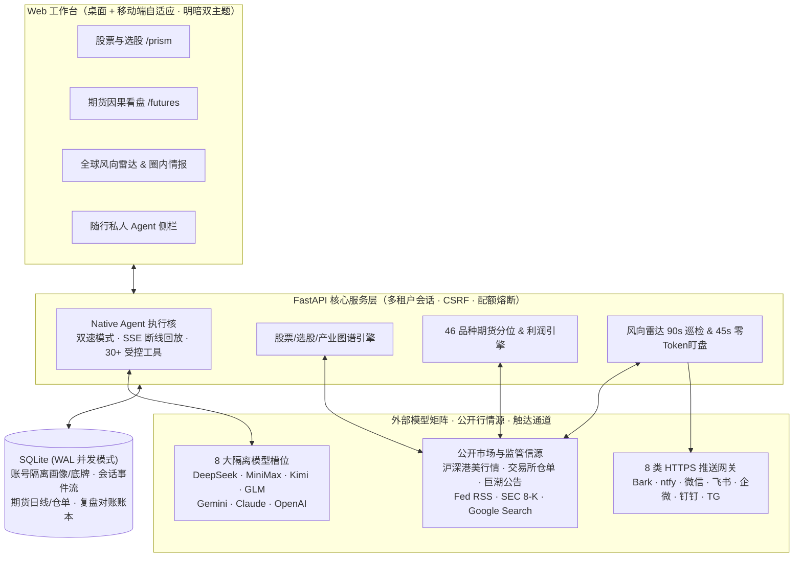

<div align="center">
  
  <h1>Prism</h1>
  <p><strong>可自行部署的开源多资产 AI 投研工作台 · Open-Source Self-Hosted Multi-Asset Research Workbench</strong></p>

  <p>
    <a href="https://github.com/doubleh-ai/prism/actions/workflows/ci.yml"></a>
    <a href="https://github.com/doubleh-ai/prism/releases"></a>
    <a href="https://github.com/doubleh-ai/prism/tags"></a>
    <a href="LICENSE"></a>
    <a href="pyproject.toml"></a>
    <a href="CONTRIBUTING.md"></a>
  </p>

  <p>
    <a href="#核心能力">核心能力</a> ·
    <a href="#设计原则">设计原则</a> ·
    <a href="#系统架构">系统架构</a> ·
    <a href="#快速开始">快速开始</a> ·
    <a href="#模型与环境变量配置">模型配置</a> ·
    <a href="#文档导航">文档导航</a> ·
    <a href="#开发与贡献">参与贡献</a>
  </p>
</div>

---

**Prism** 是一个轻量、透明、可私有化部署的 AI 投研与多市场协同工作台。它围绕 **股票与量化选股、国内 46 品种商品期货因果看盘、全球与盘中突发风向雷达、小范围圈内情报对账、0-Token 私人盯盘守望与随行私人投研 Agent** 构建，坚持**可核验的数据溯源、严格的多租户隐私隔离与零黑盒的工程架构**。

## 设计原则

| 原则 | 工程落地方式 |
|---|---|
| **事实与推断严格分离** | 行情交易日、公告发布时间与采集时间独立标注；外部数据源缺失或受限时显式提示 `unavailable / stale`，绝不插值、补零或静默编造数字。 |
| **多租户隐私物理隔离** | 每个账号拥有独立的投研画像、私有仓位底牌与个人盯盘规则；Agent 工具层内置防外泄护栏，管理统计仅保留脱敏聚合计数。 |
| **8 大模型厂商隔离直连** | 原生 HTTP 运行器直连 DeepSeek、MiniMax（国内/国际）、Kimi、智谱 GLM、Google Gemini、Claude 与 OpenAI，支持预算熔断、SSE 断线回放与真实取消。 |
| **零重型依赖 · 单机即跑** | Python 3.12 + FastAPI + SQLite WAL + 原生 Vanilla JS（无前端打包编译链、无 Redis/MQ 重中间件），克隆后 1 分钟即可启动完整工作台。 |

---

## 核心能力

### 1. 股票与量化工作区 (`/prism`)
- **多周期行情与基本面**：支持 A 股实时快照、明确复权口径的日/周/月 K 线、PE(TTM)/PB/总市值速览及专业指标悬停释义词典。
- **确定性选股与指标实验室**：支持可视化指标参数配置、自然语言辅助公式转换与全市场异步条件扫描，扫描结果可一键交由随行 Agent 结合个人排雷清单优中选优。
- **产业链与商品锚联动**：内置上下游产业链图谱与大宗商品期货锚（如算力硬件、电网铜铝、新能源锂硅等），区分已核验披露证据与待考证假设。

### 2. 商品期货极值与因果看盘 (`/futures`)
- **五大交易所 46 个主力品种**：完整覆盖 SHFE、INE、DCE、CZCE、GFEX 主力品种，首屏直出近 5 年历史分位、历年同期季节性分位温度条与主力换月跳空预警。
- **14 组盘面利润与四阶传导画布**：同日确定性计算高炉螺纹毛利、卷螺差、大豆盘面榨利、玻璃—纯碱差等加工利润，并提供「上游资源 → 中游冶炼 → 下游终端 → A 股映射」四阶因果画布。
- **期现基差与官方仓单对账**：整合现货价格序列、交易所仓单库存、近远月期限结构与后台定时异动预解读。

### 3. 全球与盘中突发风向雷达 (`/prism?mode=radar`)
- **6 路中英一手源并行巡检**：后台定时聚合财联社电报、新浪 7×24、东方财富全球快讯、美联储官方新闻稿（Fed RSS）、美国 SEC `8-K` 重大临时披露及 CNBC 全球科技/宏观源，内置跨源同题去重与 `T0 / T1 / T2` 反噪音分级。
- **跨市场实时价格印证（Cross-Asset Tape）**：0 Token 联动离岸人民币（`USD/CNH`）、沪深 300、恒生科指、纳斯达克及黄金/铜/原油主力涨跌，快速辨别盘中传闻与资金真共振。
- **实时联网溯源与 8 通道强提醒**：支持按需调用 Google Gemini + `google_search` 全网溯源核验，并支持接入 **Bark（iOS/macOS）、ntfy、PushPlus / Server酱、飞书、企业微信、钉钉及 Telegram** 推送通道。

### 4. 圈内情报池与私人投研助理 (`/prism?mode=intel`)
- **圈内线索结构化与实盘对账**：支持一键粘贴调研纪要或策略观点，自动拆解「空仓 / 底仓 / 重仓」条件分支与核验信号，叠加实时盘面冷热校验，支持匿名分享与到期收盘价对账。
- **私有仓位保险箱与 0-Token 守望**：用户可维护仅本人可见的总仓位成数与核心持仓（提问时自动注入本人 Agent 对号入座），并可用一句话自然语言创建 **45 秒周期零 Token 后台盯盘规则**（覆盖个股、指数、期货点位及快讯关键词）。

### 5. 跨板块随行私人 Agent (`Prism Native Copilot`)
- **敏捷 / 深度双速引擎**：`敏捷`模式首帧自动预注当前视口实时行情、估值与产业链快照，秒级直出结论；`深度`模式自主调取公告 PDF 原文与多轮工具核验。
- **5 套一键投研画像模板**：内置「稳健底仓 · 龙头白马」「主线景气 · 右侧趋势」「产业供需 · 股期联动」「催化快反 · 小仓试错」「低波红利 · 绝对收益」基础模板与个体化纪律记忆卡。

### 6. 全域可证伪复盘账本 (`/prism?mode=reports`)
- **多空判断闭环**：统一记录股票、期货与圈内情报的多空方向、目标验证位与失效止损线，到期按实盘收盘价一键对账统计胜率分布与认知偏差。

---

## 系统架构



---

## 快速开始

> **零密钥即可完整体验**：无需配置任何大模型 API Key，即可直接启动并浏览实时股票行情、条件选股、46 品种期货极值、全球风向雷达与圈内情报池；AI 对话可随时按需注入任意一家模型 Key 开启。

### 方式一：本地源码启动（推荐，Python 3.12）

```bash
git clone https://github.com/doubleh-ai/prism.git
cd prism

# 1. 创建虚拟环境并安装核心依赖
python3.12 -m venv .venv
source .venv/bin/activate
python -m pip install -r requirements.txt

# 2. 配置独立数据目录与初始账号
mkdir -p "$HOME/.local/share/prism-dev"
export STOCK_DATA_DIR="$HOME/.local/share/prism-dev"
export STOCK_LOG_FILE="$STOCK_DATA_DIR/app.log"
export ADMIN_USER=local-admin
read -r -s -p "Set local password: " ADMIN_PASS && echo
export ADMIN_PASS

# 3. 一键启动服务（默认监听 http://127.0.0.1:8088）
make PYTHON=.venv/bin/python run
```

启动后在浏览器打开 `http://127.0.0.1:8088` 登录，点击右上角 **`?`** 即可开启交互式功能导览。

### 方式二：Docker 容器部署

```bash
docker build -t prism:latest .
docker run -d --name prism \
  -p 8088:8088 \
  -v "$(pwd)/prism-data:/app/data" \
  -v "$(pwd)/prism-logs:/app/logs" \
  -e ADMIN_USER=admin \
  -e ADMIN_PASS=change-me-strong-password \
  -e DEEPSEEK_API_KEY=your-deepseek-key \
  prism:latest
```

> 生产公网部署建议前置 Nginx / Caddy 启用 HTTPS，并设置 `PRISM_COOKIE_SECURE=1` 与 `PRISM_ALLOWED_ORIGINS`。应用直接从进程环境变量读取配置，**不会自动读取磁盘 `.env` 文件**（[`.env.example`](.env.example) 仅作为配置清单参考）。

---

## 模型与环境变量配置

所有模型服务商均采用**独立密钥槽位与独立协议适配器**，严禁跨厂商混用凭证。完整模板见 [`.env.example`](.env.example)：

| 变量名 | 用途说明 | 协议适配器 |
|---|---|---|
| `DEEPSEEK_API_KEY` | DeepSeek 官方 API Key（`deepseek-chat` / `deepseek-reasoner`） | Anthropic Messages HTTP |
| `MINIMAX_CN_API_KEY` / `MINIMAX_API_KEY` | MiniMax 国内直连 / 国际站官方 API Key | Anthropic Messages HTTP |
| `KIMI_API_KEY` | Moonshot Kimi 官方 API Key（如 `kimi-k2`） | Anthropic Messages HTTP |
| `GLM_API_KEY` | 智谱清言 BigModel 官方 API Key（如 `glm-4.6`） | Anthropic Messages HTTP |
| `GEMINI_API_KEY` | Google AI Studio / Gemini 官方 Key（支持原生推理与雷达 `google_search` 溯源） | Gemini `generateContent` HTTP |
| `ANTHROPIC_API_KEY` | Anthropic Claude 官方 API Key | Anthropic Messages HTTP |
| `OPENAI_API_KEY` + `OPENAI_MODEL` | OpenAI 官方 API Key（需同时显式指定 `OPENAI_MODEL`，如 `gpt-4.1`） | OpenAI Responses HTTP |
| `PRISM_DEFAULT_MODEL` | 全站默认模型槽位 ID（用户也可在前端自由切换个人偏好模型） | 可选 |
| `STOCK_DATA_DIR` | SQLite 数据库与本地缓存目录 | 推荐设置 |
| `ADMIN_USER` / `ADMIN_PASS` | 首次启动自动创建的初始登录账号（也可使用 `scripts/create_user.py`） | 首次启动 |
| `PRISM_TUSHARE_TOKEN` | 可选 Tushare Pro Token，补充期货扩展量化数据复核 | 可选 |
| `PRISM_COOKIE_SECURE` / `PRISM_ALLOWED_ORIGINS` | 生产 HTTPS Cookie 保护与允许的浏览器 Origin 白名单 | 生产推荐 |

---

## 文档导航

| 主题 | 文档链接 |
|---|---|
| 快速上手、模块导览与日常工作流 | [项目指南](docs/PROJECT_GUIDE.md) · [功能支持边界](docs/CAPABILITY_STATUS.md) |
| 系统架构、代码目录地图与扩展指南 | [架构与代码地图](docs/ARCHITECTURE.md) |
| Native Agent 状态机、预算控制与 SSE 回放 | [Native Agent 框架](docs/native-agent-framework.md) · [平台能力目录](docs/platform-capabilities.md) |
| 46 品种期货数据源矩阵、复权与价差口径 | [期货数据源矩阵](docs/FUTURES_DATA_SOURCES.md) · [期货研究说明](docs/futures-research.md) |
| 持仓风险检查、研究质量与诚实溯源边界 | [持仓与风险检查](docs/portfolio-risk.md) · [研究质量评估](docs/research-quality.md) |
| HTTP API 路由契约与安全边界 | [API Reference](docs/API.md) · [监控与管理边界](docs/monitoring-boundaries.md) |
| 产品克制原则、UI 视觉规范与发布流程 | [产品原则](docs/product-principles.md) · [界面规范](docs/ui-guidelines.md) · [发布规范](docs/release-process.md) |
| 历次版本演进记录 | [CHANGELOG.md](CHANGELOG.md) |

---

## 开发与贡献

欢迎提交 Issue 与 Pull Request！本项目采用**固定双分支（`dev` → PR → `main`）+ SemVer Tag 发布流**，提交前请运行仓库内置的一键门禁（需 Python 3.12 与 Node.js 22+）：

```bash
# 1. 安装锁定依赖与开发检查工具，并启用本地 Git 钩子
make install-dev
make hooks

# 2. 运行提交前全量门禁（开源卫生扫描 + 密钥隔离验证 + Ruff + Node 前端契约 + 核心 Pytest）
make check

# 3. 运行带覆盖率的全量测试套件
make test-cov
```

- **贡献规范**：详见 [CONTRIBUTING.md](CONTRIBUTING.md)、[AGENTS.md](AGENTS.md) 与 [CODE_OF_CONDUCT.md](CODE_OF_CONDUCT.md)。
- **安全上报**：如发现潜在安全问题，请按 [SECURITY.md](SECURITY.md) 私密上报，请勿在公开 Issue 中贴出漏洞利用细节或任何真实密钥。
- **合规与免责声明**：Prism 仅用于个人与团队投资研究辅助、公开信息聚合与逻辑复盘，**不构成任何投资建议、收益承诺或自动化交易指令**。外部免费行情源与大语言模型输出均可能存在延迟、缺口或偏差，请始终以交易所及上市公司法定原始披露为准独立决策。

## License

Copyright © Prism Contributors. Licensed under the [Apache License 2.0](LICENSE).
