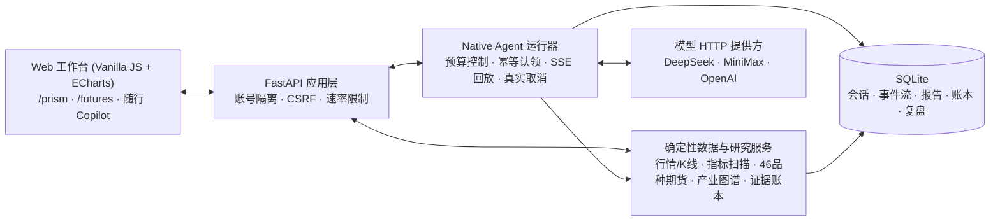

# Prism

[](https://github.com/doubleh-ai/prism/actions/workflows/ci.yml)
[](LICENSE)
[](pyproject.toml)
[](https://github.com/doubleh-ai/prism/releases)

**Prism** 是一个可自行部署的开源 AI 投研工作台，围绕 **股票与量化看盘、国内商品期货深度研究、跨板块随行研究 Agent（Copilot）与个人投研复盘账本** 构建，主打**可核验的数据溯源、直觉化可视化与克制透明的 AI 辅助研究**。

---

## 核心能力

### 1. 股票与量化工作区 (`/prism`)
- **行情与 K 线**：支持 A 股实时/日线/周线/月线行情（明确复权口径与数据源标注）、多周期技术指标叠加、自选管理与全市场条件选股扫描。
- **自定义指标实验室**：支持可视化参数配置与自然语言辅助翻译指标条件，所有指标计算与扫描均采用确定性引擎执行。
- **产业图谱联动**：内置行业上下游图谱，支持登记研究主张、供需关系、反方证据与失效条件，区分背景连线与已核验事实。

### 2. 期货深度研究工作台 (`/futures`)
- **46 个国内主力品种覆盖**：横跨上期所（SHFE）、能源中心（INE）、大商所（DCE）、郑商所（CZCE）、广期所（GFEX），统一展示连续日线、5 年历史分位与季节性分位温度条、主力换月跳空检测。
- **盘面利润与产业链传导**：内置 14 组同日确定性跨品种盘面利润/比价（如高炉螺纹毛利、卷螺差、大豆盘面榨利、玻璃—纯碱差等）以及「上游资源 → 中游冶炼加工 → 下游消费 → A 股行业映射」四阶期·现·股联动画布。
- **多维事实与机构证据**：按品种展示交易所官方仓单、近远月期限结构、现货基差与机构研报观点；缺失数据与反爬受限均显式标注，不插值、不补零、不伪造。

### 3. 跨板块随行研究 Agent（Prism Native Copilot）
- **原生直接 HTTP 运行器**：内置有预算、可取消、可断线回放的 Native Agent 运行器，直接调用 DeepSeek / MiniMax / OpenAI HTTP API，不依赖外部 CLI 或黑盒编排框架。
- **视口感知与双速阅读**：在股票、期货、复盘库之间无缝伴随，自动感知当前浏览标的；支持边缘拖拽调宽、能力调用轨迹顶部折叠与居中宽屏沉浸阅读（`⤢ 精读`）。
- **证据与时点边界**：严格分离研究截至时间、来源发布时间、采集时间与行情交易日；来源链接与引用节选可逐条溯源，区分事实披露、确定性计算与模型推断。

### 4. 个人投研画像与多空复盘库
- **投研画像与风控约束**：支持配置投资风格、持仓周期、风险偏好、负面回避清单与可确认的研究习惯记忆卡，按版本快照绑定到每轮研究。
- **全域判断与自动对账**：支持记录股票与期货的多空判断与观察依据，自动跟踪后续行情变化并形成结构化复盘账本。

---

## 架构概览



- **后端**：Python 3.12 + FastAPI + Uvicorn + SQLite（零重型中间件依赖，单进程即可运行）。
- **前端**：原生 HTML / CSS / JavaScript + ECharts + Marked，无前端构建步骤，开箱即改即用。
- **数据安全**：账号级数据隔离、bcrypt 密码哈希、`HttpOnly` 会话 Cookie、CSRF 与 Origin 校验、HTML 报告沙箱隔离渲染。

---

## 快速开始

> **无需配置模型 API Key 即可启动并完整预览界面与行情/期货数据**；发起 AI 研究对话时按需配置对应模型提供方的 Key 即可。

### 方式一：本地运行（Python 3.12）

```bash
git clone https://github.com/doubleh-ai/prism.git
cd prism

# 1. 创建虚拟环境并安装核心依赖
python3.12 -m venv .venv
source .venv/bin/activate
python -m pip install -r requirements.txt

# 2. 指定独立数据目录并初始化本地管理员密码
mkdir -p "$HOME/.local/share/prism-dev"
export STOCK_DATA_DIR="$HOME/.local/share/prism-dev"
export STOCK_LOG_FILE="$STOCK_DATA_DIR/app.log"
export ADMIN_USER=local-admin
read -r -s -p "Set local password: " ADMIN_PASS && echo
export ADMIN_PASS

# 3. 启动单进程服务
python -m uvicorn server.main:app --host 127.0.0.1 --port 8088 --workers 1
```

启动后访问 `http://127.0.0.1:8088` 登录使用。

### 方式二：Docker 运行

```bash
docker build -t prism:latest .
docker run -d --name prism \
  -p 8088:8088 \
  -v "$(pwd)/prism-data:/app/data" \
  -v "$(pwd)/prism-logs:/app/logs" \
  -e ADMIN_USER=admin \
  -e ADMIN_PASS=change-me-strong-password \
  -e DEEPSEEK_API_KEY=your-deepseek-key \
  prism:latest
```

> 生产部署请通过反向代理启用 HTTPS，并设置 `PRISM_COOKIE_SECURE=1` 与 `PRISM_ALLOWED_ORIGINS`。应用直接从进程环境变量读取配置，**不会自动加载 `.env` 文件**（`.env.example` 仅作为变量模板）。

---

## 常用环境变量

完整模板见 [`.env.example`](.env.example)：

| 变量名 | 说明 | 是否必需 |
|---|---|---|
| `STOCK_DATA_DIR` | SQLite 数据库与运行数据存储目录 | 推荐设置 |
| `STOCK_LOG_FILE` | 应用日志文件路径 | 可选 |
| `ADMIN_USER` / `ADMIN_PASS` | 首次初始化账号用户名与密码（也可通过 `scripts/create_user.py` 创建） | 首次启动 |
| `DEEPSEEK_API_KEY` | DeepSeek API Key（Anthropic 兼容 Messages HTTP） | 按需 |
| `MINIMAX_API_KEY` / `MINIMAX_CN_API_KEY` | MiniMax 国际 / 国内官方 API Key | 按需 |
| `OPENAI_API_KEY` + `OPENAI_MODEL` | OpenAI Responses HTTP 接入（需显式指定模型 ID） | 按需 |
| `PRISM_DEFAULT_MODEL` | 默认模型槽位 | 可选 |
| `PRISM_TUSHARE_TOKEN` | 可选 Tushare Pro Token，用于补充期货量化数据复核 | 可选 |
| `PRISM_COOKIE_SECURE` | 生产 HTTPS 环境下设为 `1` | 生产推荐 |
| `PRISM_ALLOWED_ORIGINS` | 允许的浏览器 Origin 白名单（逗号分隔） | 生产推荐 |

---

## 文档导航

| 主题 | 文档 |
|---|---|
| 上手使用、功能边界与本地开发详解 | [项目指南](docs/PROJECT_GUIDE.md) |
| 系统架构、模块职责与扩展能力路径 | [架构与代码地图](docs/ARCHITECTURE.md) |
| Native Agent 协议、预算与事件回放 | [Native Agent 框架](docs/native-agent-framework.md) |
| 期货数据源矩阵、覆盖范围与口径说明 | [期货数据源矩阵](docs/FUTURES_DATA_SOURCES.md) · [期货资料说明](docs/futures-research.md) |
| 持仓导入与风险检查口径 | [持仓与风险检查](docs/portfolio-risk.md) |
| API 接口契约 | [API Reference](docs/API.md) |
| 产品原则、界面规范与关键设计决定 | [产品原则](docs/product-principles.md) · [界面规范](docs/ui-guidelines.md) · [设计决定](docs/DECISIONS.md) |
| 自托管部署与发布规范 | [发布规范](docs/release-process.md) |
| 版本更新记录 | [CHANGELOG](CHANGELOG.md) |

---

## 开发与测试

需要 Python 3.12，完整前端运行时回归另需 Node.js 22+：

```bash
# 安装锁定依赖与测试工具
make install-dev

# 启动前凭证隔离检查（零依赖）
python3 -I -S -B scripts/check_provider_key_isolation.py

# 代码检查与格式校验
python -m ruff check server/ tests/
python -m ruff format --check server/ tests/

# 运行全量自动化测试
python -m pytest tests/ --cov=server --cov-report=term-missing
```

---

## 贡献、安全与免责声明

- **参与贡献**：请阅读 [CONTRIBUTING.md](CONTRIBUTING.md) 与 [CODE_OF_CONDUCT.md](CODE_OF_CONDUCT.md)。
- **安全漏洞上报**：请勿在公开 Issue 中提交漏洞细节、密钥或用户数据，详见 [SECURITY.md](SECURITY.md)。
- **免责声明**：本项目仅用于投资研究辅助与数据整理，**不构成任何投资建议或自动交易指令**；公开数据源与大模型输出均可能存在延迟、缺口或误差，请结合交易所及上市公司原始披露独立判断。

## License

本项目基于 [Apache License 2.0](LICENSE) 开源。
