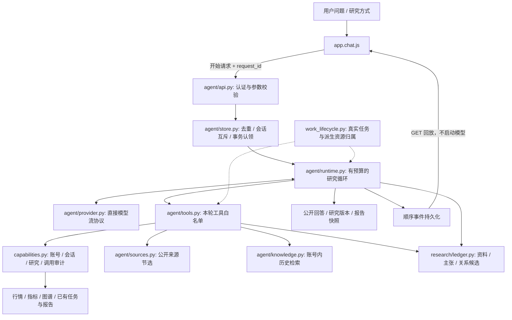

# Prism 架构与代码地图

本文描述仓库中的 Native Agent 源码，不记录特定实例的部署状态。版本与部署的区别见 [README](../README.md#版本与上线状态)。预算、协议细节见 [Native Agent v1](native-agent-framework.md)；产品使用见 [项目指南](PROJECT_GUIDE.md)。

## 一次研究经过哪些边界

整个应用禁止依赖或回退到 Claude Code CLI。上图中的原生研究通过进程内工具调度，不读取外部 Skill，不使用 MCP 桥或应用对自身的回环 HTTP。模型可以提出工具请求，实际执行权仍由服务端 schema、白名单、账号与本轮任务控制。

### 应用运行组件与入口

| 组件 | 入口 | 当前执行方式 |
|---|---|---|
| 研究对话 | `server/agent/api.py` → `runtime.py` | 直接 HTTP 模型协议与有界工具循环 |
| 旧对话 URL | `server/main.py`、`server/chat.py` | 只映射 Native 开始/停止；旧交互回应返回 409，无旧运行器开关 |
| 辅助模型 | `server/services/auxiliary_model.py` | 无状态直接 HTTP；无工具、会话、子进程、重试或备用后端 |
| 历史对话 | `server/conversations.py` → `legacy_history.py` | 只读平台 SQLite 中的公开历史；离线导入单独执行 |
| Astock / 行情 / 扫描 | `analysis_engine.py`、`market/`、`indicators/scanner.py` | 专用 Python 服务或可选第三方 Python 引擎，不是 Claude Code |
| Vibe | `server/vibe.py` | 新研究与追问固定 503，仅保留账号内已保存历史 |
| 健康观察 | `server/health.py` | 检查 Native 入口、目录与本地模型配置；不调用模型或 CLI |

提供方采用 Anthropic 兼容 Messages 协议，只表示 HTTP 消息与流事件格式；不依赖 Claude Code。现有 DeepSeek / MiniMax 模型配置继续使用。

## 控制面：开始、运行、观察、停止

### 开始与执行

[`agent/api.py`](../server/agent/api.py) 接受已有会话中的研究请求，校验登录、模型配置及参数，再创建原生任务。稳定的 `request_id` 加输入摘要用于去重：同输入重用同任务，冲突输入拒绝；数据库认领保证不会因调度重复而执行两次。同一会话最多一轮活跃研究。

[`NativeAgent`](../server/agent/runtime.py) 持有真实的 `agent` Lease，运行有界模型—工具循环。`prompts.py` 提供综合、产业链、公司三种版本化方法；旧 `prism-research` / `bottleneck-hunter` / `serenity` 名称仅保留接口兼容，不对应读取磁盘 Skill。

工具返回后，模型可以继续分析；这是原研究的正常续接，不是失败请求重试。模型流失败、超时或预算耗尽会保留已有公开内容和已观察用量；没有报告的字段保持未知，不用零补齐，也不自动换提供方。

### 观察与刷新

事件通过 `store.append_event` 保存后才提供给网页。SSE 的 `agent` 元数据包含 `run_id`、`conv_id`、`seq`、事件状态、引擎和研究方式。状态属于该事件发生时，回放旧事件不会因任务后来完成而提前终止。

- 首次开始使用 `POST /api/agent/chat/stream`。
- 活跃读者断线，最多三次 `GET /api/agent/runs/{id}/stream?after_seq=N` 接续。
- 网页刷新后，`app.core.js` 读取账号内会话；`app.chat.js` 从持久化任务标识重新建立读者。没有历史游标时从序号零重建该消息，而不是把回放叠加到旧正文上。
- 序号用于跳过重复事件、发现缺口。GET 回放不会运行模型、工具或创建新问题。

前端内存中的 `Streams` 只是当前读者及显示缓存，不是后台任务的唯一事实来源。跨会话迟到事件只能更新原消息数组，不能写进当前会话。

### 停止与真正完成

取消请求写入所属任务的取消意图。运行器停止模型等待，等待已经归属的资源收尾并保存结果，然后通过 `Lease.finish` 与终态事件确认完成。网页不能把取消 API 的受理响应直接当成“底层已经停止”。

[`work_lifecycle.py`](../server/work_lifecycle.py) 管理 `request`、`agent`、`analysis`、`scan`、`market`、`auxiliary`、`capability`、`diagnostic` 等生产者；`work_adapters.py` 把 HTTP 和业务工作绑定到真实归属。取消异步等待不会凭空终止线程或清空计数。维护排空必须包括原生 Agent 及其派生工作，详见 [任务归属与排空](work-lifecycle.md)。

## 数据面：执行、证据、报告分别保存

SQLite 路径由 `server/config.py` 的 `STOCK_DATA_DIR` 和 `server/database.py` 确定。下表是主要职责，不是完整备份清单。

| 数据 | 主要位置 / 模块 | 它证明什么 |
|---|---|---|
| 用户、会话、消息 | `users`、`conversations`、`messages`；`auth.py` / `conversations.py` | 归属、公开对话与回收站状态 |
| 已导入的旧公开历史 | `legacy_conversation_history`；`legacy_history.py` | 账号内公开消息、真实用户回合数及源指纹；服务时不打开外部历史文件 |
| 原生运行 | `native_agent_runs`；`agent/store.py` | 请求、执行状态、取消意图与有限摘要 |
| 原生事件 | `native_agent_events` | 该任务已持久化的公开顺序事件及用量状态，用于原样回放 |
| 对话关联 | `native_agent_dialogues` | 原生运行与用户/助手消息及历史边界的联系 |
| 工具审计 | `capability_runs` / `capability_calls`；`capabilities.py` | 实际工具调用、状态、结果快照和目标页面 |
| 研究与资料 | `research_runs`、`research_documents`、`research_passages` | 研究时点、取得的资料信息与有限节选 |
| 主张与关系 | `research_claims`、`research_relations` | 本轮候选判断、引用定位、计算及传导条件 |
| 研究版本 | `research_revisions` | 本轮冻结的内容块、状态、引用和缺口 |
| 报告库 | `saved_reports`；`reports.py` | 可以在网页回看的报告快照 |

**执行状态与证据状态分开。** 模型循环 `completed` 表示执行收尾，不表示报告内容已通过语义审查。引用存在、所属本轮、节选匹配、计算口径等结构检查，也不能直接证明结论语义正确。当前研究修订可能因证据缺口为 `partial` / 待核验，而任务执行已完成。

来源页面不会获得执行指令的地位。`sources.py` 限定公开 HTTPS 主机、解析大小、时间和连接地址；`research_context.py` / `source_urls.py` 处理来源展示和清理；`research/ledger.py` 保留来源、日期、节选、主张与反证的联系。取得节选不等于取得完整原件，搜索线索也不能补成原文。

最终公开消息和报告写入时再次校验账号有效、会话未删除且仍属该用户。删除或停用不会授权运行器重建内容。`public_text.py` 从历史结构中提取公开回答，过滤私有思考、签名和不支持的结构；提供方续接所需的私有块只在当轮内存中使用。

## 知识保存与“自演进”的当前边界

[`knowledge.py`](../server/agent/knowledge.py) 直接读取账号内研究版本和报告，以有界文本匹配返回候选及原日期，排除本轮，遵守删除与停用边界。它没有独立向量索引、模型权重更新或跨账号公共知识池。

当前实现的是**可积累、可回看、可检索的研究记录**。尚未实现的是持续自动事实审查、自动刷新全部旧结论、从纠正中训练模型、无人审批的代码自修改或生产自发布。以后增加这些能力，应建立明确的验证与发布流程，不能把保存次数当作可信度或训练次数。

## 按文件定位

| 代码 | 修改它时重点检查 |
|---|---|
| `server/main.py` / `config.py` | Native 路由组装、初始化会写数据库、模型与数据配置 |
| `server/agent/api.py` / `store.py` | 账号、幂等、会话互斥、原子认领、取消、事件序号与终态 |
| `server/agent/runtime.py` | 全轮预算、上下文、模型/工具等待、资源完成、最终持久化 |
| `server/agent/provider.py` | 分帧、工具参数、停止原因、用量完整性、提供方地址和超时 |
| `server/agent/prompts.py` | 方法和研究规则；不能只靠提示词授予权限 |
| `server/agent/tools.py` / `server/capabilities.py` | 封闭工具参数、真实账号与任务、审计、结果过滤和幂等 |
| `server/agent/sources.py` / `knowledge.py` / `public_text.py` | 外部资料与历史记录的安全、时效、公开文本投影 |
| `server/research/ledger.py` / `routes.py` | 资料—主张—关系—版本，账号内只读页面接口 |
| `static/js/app.core.js` / `app.chat.js` | 会话加载、读者恢复、停止、重复事件和跨会话竞态 |
| `static/js/app.chat-render.js` / `app.research.js` / `app.reports.js` | 公开内容、证据和报告展示 |
| `static/js/app.workbench.js` | 能力目录、调用卡片、打开原结果而非重跑 |
| `static/js/app.industry.js` | 产业关系页面、主题切换和证据边界 |

`server/services/claude_runner.py`、根目录 `CLAUDE.md` 与捆绑 `skills/` 已移除。`server/chat.py` 只保留 Native 路由名兼容；仓库保留的旧 MCP 协议代码或运维探针不再是应用执行入口，也不能重新启用 CLI。Astock 的第三方 Python 引擎尚未变成自有 Agent；Vibe 执行明确禁用，不能宣传为已迁移或可用。

旧 JSONL 由 `scripts/import_legacy_history.py` 显式导入操作员预先准备的数据库副本与历史目录副本。导入仅保留公开问答、回合数和源指纹，拒绝不安全路径与源冲突，保持现有 SQL 消息和 Native 历史锚点。应用启动与历史请求不会运行导入器，也不再读取外部 CLI 的项目或设置目录。未迁入的会话返回 `pending_import`，不假装历史已完整恢复。

## 增加能力的最小路径

1. **定义语义与合同**：输入封闭 schema、只读或写入属性、结果与来源类型、数据期间、错误分类、记录及目标页面。不要接受任意用户名、文件路径、SQL 或命令。
2. **实现业务服务**：复用明确的业务实现，而不是让模型调用浏览器、Shell 或任意 HTTP。后台工作必须绑定真实 Lease；超时后仍需知道底层是否完成。
3. **接入平台调度**：在 `capabilities.py` 的 schema / `REGISTRY` / 调度中保留账号与会话校验、幂等、审计和结果快照；`native_run_context` 只接受真实原生父任务。
4. **明确加入原生白名单**：纳入 `agent/tools.py` 的 `PLATFORM_TOOLS`，或为专用来源/知识能力实现相同边界。全平台目录新增一项不会自动向 Agent 开放。
5. **贯通页面与记录**：复用 `call_id`、`run_id`、`conv_id`，让卡片打开当时结果；刷新、重放、跨会话导航都不能重新执行动作。
6. **验证失败路径**：模拟提供方与资料，覆盖越权、同请求复用、冲突、断线、真实停止、资源收尾、缺失日期和未知用量。新增付费或外部集成另做有限真实验收。

Astock / Vibe / 扫描启动等能力必须按这条路径逐项接入。新增能力不得调用 Claude Code CLI，也不得在模型、工具或提供方失败后切换到旧执行链。

## 运行与发布是另一条边界

公开应用的管理员观察页、CI 和候选打包器不持有生产执行权。环境专属控制源码、来源清单与回执位于私有运维仓库和私有存储；研究工具不能调用它们。

应用、配置、依赖和运行数据分别固定。升级要有新候选的实际隔离、模型协议、任务排空、备份恢复和兼容回退证据；把提交同步到 `master` 只改变代码主线。入口见[项目指南](PROJECT_GUIDE.md#发布停止与回退)，合同见[发布规范](release-process.md)。
