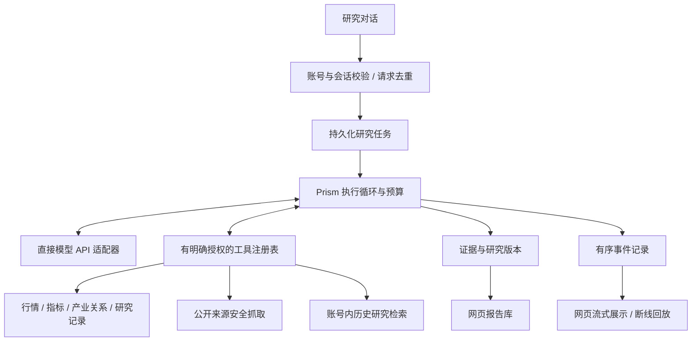

# Prism Native Agent v1

本方案将研究对话的执行权交还 Prism。工作流、模型协议、执行预算、工具授权、研究证据、历史检索、状态保存与网页展示均由仓库代码实现。基础模型通过 HTTP API 提供推理；这里的自研指 Agent 框架，不是训练基础模型。

本文描述仓库中的原生研究对话，不记录特定实例的部署状态。**整个 Prism 应用只允许 Prism Native 与直接模型 HTTP，禁止依赖或回退到 Claude Code CLI**；不读取外部 Skill，不通过 MCP 桥或本机回环 HTTP 执行原生工具，也不依赖其他 Agent SDK。辅助模型直接使用 HTTP。旧个股自动分析的模型编排、缓存与辅助提取实现已移除，兼容启动入口固定返回 503；Vibe 新研究与追问也保持 503。账号内已保存历史仍可读取。

## 为什么重构

旧研究链路把会话、工具和报告交给通用编码 CLI，浏览器只能观察其输出和进程退出状态。一个非零退出码不能说明模型、工具、研究完整性各自的状态，也不适合作为可追溯研究的边界。继续叠加 Skill 和 PDF 模板无法解决执行归属、恢复、测试和专业证据的问题。

新系统以一次持久化研究任务为单位，分别记录执行状态和研究结论可信度。执行完成仅表示本轮模型与工具循环结束，绝不代表结论已核验或投资建议正确。

## 核心结构

| 模块 | 职责 |
|---|---|
| `server/agent/provider.py` | 直接实现 Anthropic 兼容 Messages 流协议，支持现有 DeepSeek / MiniMax 地址；解析文本、工具和用量；思考签名仅在内存中用于续接，不进入网页或数据库。 |
| `server/agent/runtime.py` | 有上限的模型—工具循环，真正后台任务归属、停止、历史上下文、版本和结果保存。 |
| `server/agent/store.py` | SQLite 任务、顺序事件、事务认领、提交去重、取消意图和中断记录。 |
| `server/agent/tools.py` | 由真实任务授权的平台工具与来源/知识工具；不提供任意 Shell、文件系统或代码执行。 |
| `server/agent/sources.py` | HTTPS 公共资料抓取、来源白名单、DNS 和连接地址校验、大小/时间上限、页面节选。 |
| `server/agent/knowledge.py` | 账号内历史研究与报告的只读检索，保留原研究时间和待核验状态。 |
| `server/agent/prompts.py` | 内置综合研究、产业链、公司研究三种方法和证据规则。方法是版本化代码，不是外部 Skill 文件。 |
| `server/agent/api.py` | 开始、停止、任务查询和有序事件回放；回放请求不会触发模型。 |
| `server/services/auxiliary_model.py` | 术语、标题等辅助任务的有界直接 HTTP 调用；无工具、会话、CLI、重试或备用执行器。 |
| `server/legacy_history.py` | 从平台 SQLite 读取已迁入的公开旧历史；离线导入不属于请求或启动路径。 |
| `server/health.py` | Native 模块、工具目录与提供方本地配置检查，不发送模型请求。 |

## 执行与恢复约束

- 浏览器每个问题只发送一次开始请求并携带请求标识。相同标识及输入复用同一个研究任务，修改输入复用标识会冲突。同一会话同时最多一轮活跃研究，一个账号最多三轮；单进程同时执行最多四轮。
- 默认每轮最多 6 次模型请求、16 次平台/资料工具调用、4 次服务器搜索、180 秒、每次 2,048 输出 token，另有内容和上下文大小限制。DeepSeek 的服务器搜索每次请求最多使用两次，并按本轮剩余额度缩减。达到预算保存部分结果；失败没有自动重试。令牌计数缺失或中断时保留未知，不能按零计费。
- 模型对话中后续工具请求属于同一研究循环，不是自动重试未知的失败请求。工具调用标识具有本轮去重与参数冲突检查。
- 每个面向网页的事件先写数据库再发送。断线后浏览器以最后序号读取后续事件，最多三次自动重连，重复事件不重复渲染。网页刷新或重开会话后，会核对所属历史，再以 GET 接回同一任务并恢复停止入口；不重新提交研究。
- 浏览器关闭只断开读者，不取消后台任务。停止先登记意图，再等待实际模型连接关闭和已归属工作结束，最后写终态；有后台阻塞工作时不会提前宣称完全停止。
- 正常完成、部分完成、失败、取消与中断分别记录。单实例受控启动确认独占运行后可将遗留任务标记为中断；不重新发送中断前用量未知的模型请求。普通查询不会重启任务。
- 继续研究是新的明确一轮，会读取已有公开回答和研究记录。v1 不承诺从进程崩溃时的模型内部状态无缝续算。
- 新框架加入平台原有任务归属和停止保护，维护排空必须计入 `agent`。禁止为了切换版本跳过保护。

## 专业研究约定

一轮回答应先给有依据的判断，再区分事实、计算、推断、假设、反证和研究缺口。涉及实时行情或公告时必须取得实际资料，不能用模型记忆补出价格或日期。研究启动时点、当前服务器时点、来源发布时间、采集时间、数据时点分别保留，未知项保持未知。

产业链研究必须区分产品用途、行业关系和真实供货关系；公司名称或图谱连线不构成供货证据。应解释需求传导、产能和替代性、利润分配、验证条件及反例。模型可以记录候选主张和关系，记录本身不使其成为已核验事实。

来源优先级：交易所披露、公司原始公告与正式资料优先；财联社、金十、新浪用于新闻线索和交叉比对。来源等级不能替代逐条事实核验。搜索得到链接仅是线索；取得页面节选也不等于已保存全文或完成事实核验。当前页面抓取支持有限 HTML/文本，PDF、压缩页面、受阻页面明确返回资料缺口，不伪造提取成功。公司官网需由操作者加入许可主机配置，模型不能自行扩大范围。

历史研究作为待核验的内部材料返回，并标注真实保存时间、研究观察时间和来源类型。它可以帮助避免重复工作和建立连续研究，不能替代最新公告或被误称为持续训练后的模型能力。v1 检索覆盖最近 200 份报告和 200 个研究版本，精确记录标识可读取更早的所属记录；不是完整语义向量知识库。

## 工具与兼容范围

原生对话能读取行情、基本面、K 线、证券搜索、指标列表与计算、产业关系、报告、已有任务状态、自选和研究证据，并能记录本轮研究范围、候选主张及关系。新增 `source_read`、`knowledge_search`、`knowledge_get`。

`analysis_start`、Vibe 启动/追问、自然语言指标翻译、选股后台启动等尚未进入原生工具白名单。旧个股自动分析启动接口与能力分发固定返回 503，拒绝发生在数据读取、记录创建和旧成功回放之前；旧后台执行器、模型适配配置、分析缓存与提取调用已从应用代码移除，不提供环境开关。已有个股状态与报告仍可读取，个股分析按钮通过原生研究对话发起分析。指标翻译和扫描保留各自授权；Vibe 执行明确禁用。新增原生工具必须逐项建立权限、真实任务归属和停止合同，不得引入外部模型编排、CLI 或失败回退。

旧工作流名称只作为内置方法的兼容别名，不读取对应 Skill。`/api/chat/stream`、`/api/chat/cancel` 只映射 Native；旧交互回应接口返回 409，要求用户发送新消息。不存在启用旧运行器的环境开关。

历史服务只读取 SQLite。`scripts/import_legacy_history.py` 显式接受 `--staged-db` 与 `--staged-project-root`，可按现有 `--username` 限定归属；只能在操作员已准备的离线副本上执行。导入把公开问答、用户回合数、源 SHA-256 和映射存入 `legacy_conversation_history`，不修改现有 SQL 消息或 Native 锚点。相同源重复执行不重写，冲突使整次事务失败。不安全路径、链接、超限或导入期间变化的文件均拒绝。应用启动和历史请求不访问旧 CLI 目录；未迁入返回 `pending_import`，不假装历史完整。

## 接口与配置

所有原生接口要求平台登录，写接口保留 CSRF 校验。

| 接口 | 作用 |
|---|---|
| `GET /api/agent/workflows` | 内置研究方法 |
| `GET /api/agent/tools` | 原生白名单能力目录 |
| `POST /api/agent/chat/stream` | 开始或去重复用研究；需要已有 `conv_id`，建议提供稳定 `request_id` |
| `POST /api/agent/chat/cancel` | 对所属任务登记停止意图 |
| `GET /api/agent/runs/{id}` | 所属任务状态 |
| `GET /api/agent/runs/{id}/events?after_seq=N` | 分页读取持久化事件 |
| `GET /api/agent/runs/{id}/stream?after_seq=N` | 仅回放与观察 SSE 事件 |

继续使用已有 DeepSeek / MiniMax 模型环境配置。Anthropic 兼容 Messages 仅是 HTTP 协议，不是 Claude Code 依赖；凭证只在提供方认证请求头内使用，不写入记录。模型适配器拒绝未支持的地址、重定向和环境代理，不自动改用别的提供方。增加提供方必须实现相同有限协议并完成离线协议测试。

`PRISM_RESEARCH_SOURCE_HOSTS` 可额外配置以逗号分隔的公司官网主机名，不含 URL、路径、凭证或通配符。默认允许的公共来源以 `sources.py` 为准。生产特定配置放私有运维仓库，凭证和运行数据不入任何 Git 仓库。

## 验收与迁移

离线测试应使用合成账号、临时数据、模拟提供方和模拟网络，验证协议、工具归属、断线、停止、去重、历史、越权、证据和界面。离线结果不能证明真实模型协议、搜索可用性、研究质量或部署完成；这些能力必须用获准的有限合成请求单独验证。

下一阶段依次迁移公司研究与产业链的专用可验证数据工具、Astock/Vibe 可替代的分析流程、后台任务和结构化研究产物；随后增加主张级证据关联、时效刷新、用户纠正和固定研究质量评测。以真实案例上的来源覆盖、日期准确、主张证据率、跨轮引用正确率、停止可靠性、成本与延迟评价进步，不能用“报告更长”或“Agent 更多”代替质量。

部署所有者须固定完整提交、产物、依赖与配置，独立验证 Native-only 发布合同、兼容恢复、备份恢复及包含 `agent` 的全应用排空。恢复版本也须独立验收且不得依赖 CLI。历史版本、合同源码或字段齐全不能证明这些条件已满足；实例记录与执行细节应受限管理。

协议依据：[DeepSeek Anthropic 兼容接口](https://api-docs.deepseek.com/guides/anthropic_api/)、[Anthropic 流式事件协议](https://platform.claude.com/docs/en/build-with-claude/streaming)。这些文档说明协议，不证明当前配置已完成真实验收。
