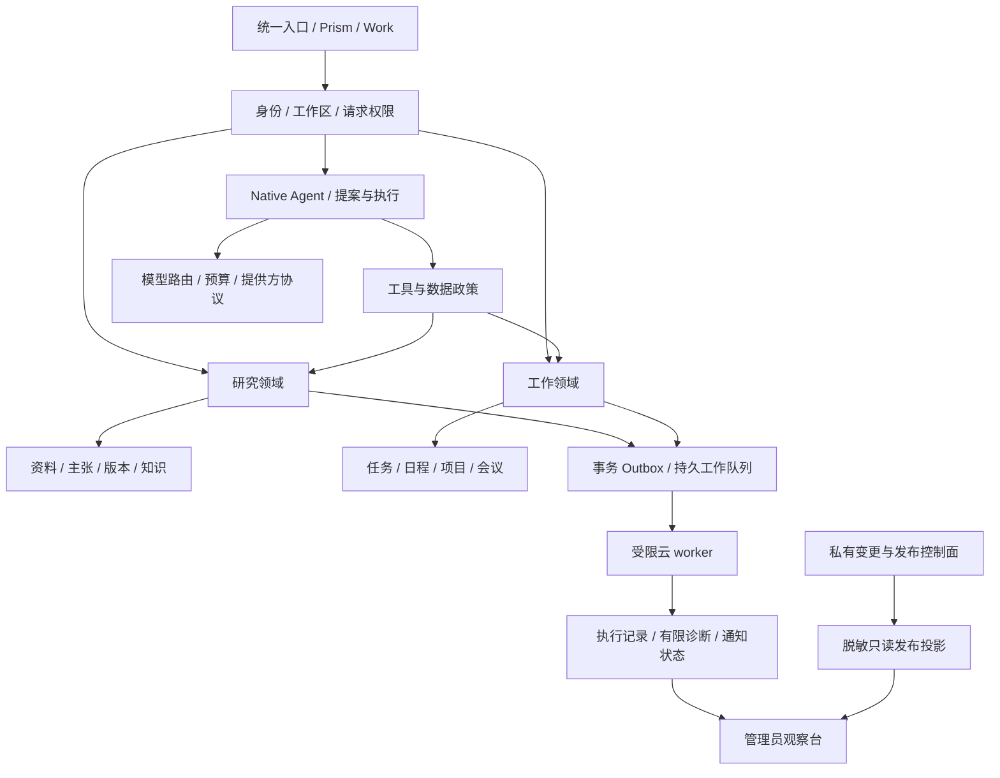

# 目标架构与边界

状态：目标设计。代码中的现有事实见 [当前架构](../ARCHITECTURE.md)，本分支第一批状态见[入口](README.md)。实例地址、凭证读取路径和实际服务控制源码不属于本文。

## 架构选择

采用**有清楚领域边界的模块单体，加独立低权限 worker 和私有运维控制面**。先解决模型、工具、数据和任务的归属，再按实际负载拆服务。初期不强制改写全部前端、不强制迁移 PostgreSQL、不引入消息中间件作为上线前置。

图中的连接不授予隐含权限。研究工具不能进入运维控制面；观察台的“可见”不等于“有权执行”。

## 模块职责

| 模块 | 拥有的数据 / 行为 | 不拥有 |
|---|---|---|
| identity / workspace | 身份、工作区、成员、角色、偏好、权限决定 | 任意请求声明的 owner |
| native agent | 计划、上下文、预算、提供方流、受限工具、取消和公开事件 | Shell、全库检索、生产发布 |
| research | 研究问题、资料、主张、关系、版本、证据缺口 | 自动晋级事实或自动交易 |
| market / asset engine | 标准资产、来源适配、时钟、计算与质量 | 用旧股价填未知数据 |
| productivity | 用户任务、日程、项目、会议和业务审计 | 后台进程的生命周期计数 |
| jobs / notifications | 调度、认领、租约、Outbox、投递回执 | 把未知结果清零或重复发送 |
| knowledge | 带权限、来源、时效和撤回状态的检索 | 无边界跨账号 / 工作区学习 |
| feedback / evolution | 分诊、建议批次、复现和改进提案 | 从用户文本获得执行权限 |
| model routing | 用途、提供方、数据等级、额度和路由版本 | 在普通设置页回传 Key |
| ops | 私有构建、验证、备份恢复、停止与发布 | 接受普通 Agent 指令 |

新 Work 源码使用 `server/productivity/`，避免与现有 `work_lifecycle.py` 的后台任务归属混淆。用户任务叫业务任务；后台执行叫 job / run / lease。

## 身份与工作区

请求上下文由服务端认证和成员校验产生，包含 principal、workspace、角色、动作、资源和策略版本。模型参数、URL 内的 workspace_id 和客户端 owner 都不是权限证据。

目标是平台不可变 user_id。迁移前沿用既有账号标识作为可信 principal，不在同一批中重写全部历史外键。个人 Work 工作区首批只有一个所有者，不提前引入团队共享。

工作区边界要贯穿：主记录、关联记录、检索索引、向量、缓存、工具快照、导出、删除、队列、附件和审计。管理员观察不能默认获得所有正文。共享必须明确对象、成员、期限和撤回语义。

当前研究知识检索只按账号隔离。**在完成研究对象工作区映射前，Work 不调用它，也不开放 Work Agent。** 后续把原研究内容映射到每个账号的研究工作区，保留所有旧 ID 和链接；完成全链隔离测试后才开放新检索入口。

账号停用立即禁止新读写与待执行动作；删除按保留政策清理关联内容与索引，审计保留最小脱敏事实。撤销成员权限同时使未执行提案和长期授权失效。运行完成写入前再次核对权限，避免删除后复活内容。

## 统一 Agent 核心

继续由自研 Native runtime 管理执行，不安装、调用或回退到 Claude Code，不读取外部 Skill 来授予工具权限。第三方基础模型与确定性库仍可使用；“自研框架”不意味着重写模型或标准组件。

页面和 Agent 调用同一业务服务。工具定义至少包含：版本化 schema、读写等级、领域、权限、数据等级、耗时 / 额度上限、幂等策略、取消语义和结果页面。

写动作采用提案 → 授权 → 执行 → 业务回执：

1. 提案固定输入、目标、工作区、对象版本、数据目的端及内容摘要。
2. 授权可为单次确认或用户明确设置的有限规则，绑定人、工具、对象范围、次数 / 额度及有效期。
3. 执行时重新核对成员、对象版本、停止状态和预算，任何漂移使旧授权失效。
4. 幂等记录和业务写入在同一事务；外部副作用另用 Outbox 与目的端幂等能力。
5. 只按实际回执显示成功。超时后“未知”是独立状态，不能自动换 ID 重试。

执行状态和内容质量分开：run completed 不等于研究结论核验通过，也不等于邀请已送达。模型不能通过返回一个 `success` 字段改变业务事实。

公开事件持久化后才送给浏览器；刷新、SSE 断线和跨端观察只读取原任务。新的研究、继续执行与历史回放是不同动作。

### 研究与 Work 的显式交接

例如“把这份研究的下次财报核对建成工作任务”，采用独立交接提案：固定源研究 ID / 版本、目标工作区、拟复制的最少字段、时间和来源链接。用户先看实际复制内容，再按目标工作区写权限确认；执行时重新检查源读取权、目标写入权和两个对象版本。研究正文不会因为创建任务而加入 Work 的检索范围，也不向 Work Agent 授予全账号研究访问权。

目标任务只保存用户确认的字段、惰性来源引用和交接 ID；不得在后台解引用填充更多正文。来源链接每次打开重新鉴权，来源删除或共享撤回后显示不可访问，不能从缓存继续展示原文。已经明确复制到目标的字段有自己的归属与保留政策；确认页须说明撤回链接不会自动收回已复制文本，用户可以删除该副本。跨域写入使用目标业务的原子去重，不采用缺少一致性保证的双库事务。

## 模型路由与连接设置

按用途配置，例如交互研究、工作规划、资料提取、异常归类、建议评审。每条路由绑定提供方、模型标识、协议适配器、数据允许范围、工具集合、消息 / token / 金额上限、超时和版本。

提供方可逐项接入 MiniMax、DeepSeek、GPT 等，但每个目的端和协议必须单独验证。先提供有限表单与实际连通状态，待数据模型稳定后再提供连线式编辑器；连线只是同一受限配置的可视表达。

Key 存于私有密钥管理，公开应用只保存引用。连接测试是显式受限动作，不在每次打开页面时消耗额度。未经许可不自动换提供方；用户允许的后备路由也必须满足相同数据等级、工具和预算边界。CLI 永远不是后备方案。

记录实际观察用量；缺失为未知。成本估算需价格来源与生效时间，不用旧单价伪装精确账单。用户工作正文默认不进入第三方模型，只有对具体用途和内容范围授权后才发送。

## 研究、知识与资产引擎

资料保存原 URL、来源、发布时间、采集时间、所涉期间、节选定位及访问 / 核验状态。研究时点由可信服务时钟提供，缺失日期不补成今天。价格交易日、报表期间、新闻时间分别建模。

知识对象保存：内容、来源、原研究、适用资产 / 项目、核验状态、观察时点、失效条件、纠正 / 撤回和权限。原始资料、模型推断、用户偏好是不同类型。检索先按权限和时效过滤，再排序；向量只是可选索引，不是事实数据库。

新结论不能仅因重复、获赞或被多个内部报告引用而晋级。晋级需原始证据和复核；纠正应能定位受影响报告，展示更新提示而不改写历史快照。先做基准问题、证据核验和回归评测，再讨论更大范围的自主学习。

资产标识包含市场、交易所、品种 / 证券、币种、合约和数据口径，不依赖一个模糊 ticker。

| 共同流程 | 股票专用 | 期货专用 |
|---|---|---|
| 资料获取、计算、证据、情景、风险、版本 | 公司 / 行业、公告、财报、估值、复权、公司行动 | 品种与具体合约、交割、主力 / 连续口径、换月、保证金、涨跌停、夜盘交易日 |
| 基本面 / 技术面 / 资金面 | 股本和流通、经营与盈利、资金口径 | 供需 / 库存 / 仓单、持仓量、基差 / 月差、期限结构及资金口径 |

期货连续价格不能当可交易合约价格；成交量不能直接解释成净流入。每项计算注明来源、单位、口径和时间。外部 Astock 先作为可替换适配器，保存许可证和固定版本；研究编排、证据、风险规则与资产合同由平台拥有，不一次性复制其全部代码。

用户风险画像独立存储和版本化。硬性约束由确定性代码校验，模型只解释与比较。首批不提供自动下单、自动杠杆或无用户确认的画像学习。

每次风险计算绑定 `profile_version`、可选的 `portfolio_snapshot` 与 `market_snapshot`：资产和数量、现金 / 负债或用户选择的必要金额、计价币种、价格来源与时点分别记录。仅有偏好不能验证真实集中度、杠杆或可承受损失。用户不提供持仓或资金时，仍可分析情景，但相应约束显示“未评估”，不能声称符合其实际组合限制。已提供但过期、单位未知或口径不兼容的输入同样不能补零。每项规则返回可核对的输入版本、计算、通过 / 不通过 / 未评估及原因；画像变化不改写历史结果。

## Work 时间、并发与审计

任务截止时刻使用带 offset 的时间和 IANA 时区；全天事项使用日期类型，不转为 UTC 零点。事件使用开始、结束、原时区、可选全天日期。重复事件保存本地规则、TZID、例外和实例身份；按 [RFC 5545](https://www.rfc-editor.org/info/rfc5545/) 建模，并在支持的规则子集外明确拒绝。

夏令时不存在或重复的本地时间必须报错或要求选择 offset；不静默选早一小时。用户可以选择上海或海外时区，不能用服务器时区替代用户选择。

更新使用 expected_version / ETag；版本不符返回冲突与最新版本，不自动覆盖。创建使用账号、工作区、动作和请求 ID 的唯一键及固定规范化内容摘要。业务更新与有限审计在同一事务。查询采用有界游标，不把前 50 条误称全部。

审计记录实际动作、对象版本、变更字段与时间；避免复制所有正文到多份日志。任务取消保留可见记录，永久删除另有明确保留与恢复政策。

## 云常驻任务与 Mac 协同

用户的提醒和已授权定时回顾由服务器 worker 运行，不依赖 Mac 或浏览器在线。初期 SQLite 事务即可保存 job、Outbox、租约和审计，使用独立连接、短事务、明确单写约束与锁等待；重载或启动多个 worker 必须先验证认领策略，不靠进程内变量。

job 具有排期、实例键、状态、尝试记录、租约持有人、过期时间和递增 fencing token。认领与更新比较 token，失效 worker 不能继续写结果。跨进程资源终止仍由真实生命周期证明；租约超时不证明底层线程、网络请求或模型已停止。

扩大开放前为用户 / 工作区设置写入速率、任务和附件容量、并行 job、定时实例数量与模型预算，统一展示可用额度和拒绝原因。数据库、队列与加密备份需监控容量和保留期，不能只限制单次请求大小；初批个人预览不等于已具备多租户容量保障。

提醒实例键由用户、业务对象、规则版本、发生时刻与渠道决定。重启可重放已提交 Outbox，但外部结果未知且无目的端幂等能力时转人工核对，不自动重复投递。接收请求成功、渠道接受和用户已读是不同状态。

Mac 是主要人工开发与决策入口；云端自主处理受限定的诊断、复现、修复分支与验证。每项变更绑定任务、基准提交、分支、负责者和租约代次。Mac 认领后云端不得覆盖其未提交成果；超时先确认旧执行已终止，再转移写权限。遇到分支冲突产出待合并提案，不强推。

发布只有一个受控写者，独立锁和停止门禁不由 Agent 修改。云端可继续分析，不代表可自行发布。未来允许的低风险自动灰度也要有固定候选、真实验收、备份恢复与介入入口。

## 控制台和交互终端

应用内控制台先展示：实际服务版本、worker 心跳、队列延迟、活动任务、失败 / 未知、备份恢复时间与对应候选、发布阶段、停止状态、数据源新鲜度、模型用量状态和配置版本。显示最后观测时间；观测不可用显示未知，不能显示绿色正常。

普通应用只读受限投影，不持有部署凭证。固定诊断动作先于交互 SSH。若确需交互终端，放在独立私有运维入口，独立身份、MFA、短会话、逐主机 / 账号授权和受限网络访问；不能在公网应用中开放任意命令 WebSocket。终端审计也须防凭证泄露，不能无差别公开录屏或终端输出。

## 工程与安全

保留现有 FastAPI 和受测服务，按领域拆路由与服务；官方 [APIRouter 模式](https://fastapi.tiangolo.com/tutorial/bigger-applications/) 支持这种渐进组织。前端先拆独立工作区并统一令牌和组件合同；是否引入构建框架由体验和维护成本决定，不把换框架当质量证明。

私有接口检查认证、CSRF、资源归属、输入大小和输出缓存。错误不得回显用户正文。用户输入、来源材料和反馈都不是指令或授权；它们不能扩大工具范围、读取密钥或跨数据边界。

账号 / 配置 API 不被 Service Worker 或 CDN 缓存；静态资源带版本。应用升级不自动导航正在编辑的客户端，显示可更新状态，由用户保护草稿后刷新。核心业务不依赖本地缓存作为唯一事实源。

前述为统一目标。现有研究页面另有账号键控的 IndexedDB 对话缓存，必须列入设备信任、账号切换、删除和旧版本清理的迁移清单；本批 Work 不复用它，也不宣称已经关闭全站私人持久缓存。

候选、环境、配置和运行数据分别固定。开源仓库存通用源码与无秘密示例；私有 ops 存实例运维源码和无凭证配置；凭证与运行数据不进 Git；旧私有 Git 历史继续离线保留。研究与 Work Agent 都不能访问运维秘密或备份解密材料。

## 可观察性与质量

贯通 request_id、workspace_id、run_id、job_id、业务对象 ID、候选修订和策略版本；日志只记录必要有限字段。保留实际失败和未知，不覆盖为成功。

建立用户旅程评测而非仅接口绿灯：页面可读、保存可靠、并发不覆盖、研究来源可核对、时区正确、取消真实完成、提醒可追踪、账号隔离。记录真实分位延迟和失败率后再设服务目标；没有采样前不虚构指标。
